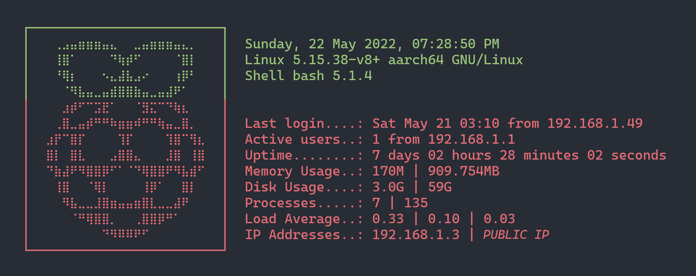

# Raspberry Pi Server

> **Trabajo de Fin de Grado (Bachelor's Thesis)**  
> *Grado en Ingeniería Informática — Escuela Técnica Superior de Ingenieros Informáticos*  
> *Universidad Politécnica de Madrid (UPM)*  
> **Título:** Servidor Doméstico sobre Raspberry Pi Automatizado y Configurable  
> **Autor:** Rodrigo Gómez de la Rosa  

[](https://opensource.org/licenses/MIT)
[](https://nodejs.org/)
[](https://reactjs.org/)
[](https://nginx.org/)
[](https://www.openssh.com/)
[](https://www.mongodb.com/)

---

## 📖 Overview / Visión General

| English | Español |
| :--- | :--- |
| **Raspberry Pi Server** is an end-to-end automated platform that transforms a standard Raspberry Pi into a secure, hardened, and modular home server. It includes complete network and security configuration, automated TLS reverse proxying, systemd lifecycle management, and a full-stack household energy monitoring web application. | **Raspberry Pi Server** es una plataforma automatizada integral que transforma una Raspberry Pi en un servidor doméstico seguro, robusto y modular. Incluye configuración completa de red y seguridad, proxy inverso TLS automatizado, gestión mediante systemd y una aplicación web completa para el control y análisis del consumo energético doméstico. |
| [📘 English Configuration Guide](./doc/config-en.md) • [📋 Script Architecture](./doc/script-en.md) | [📗 Guía de Configuración en Español](./doc/config-es.md) • [📋 Arquitectura de Scripts](./doc/script-es.md) |

---

## 🚀 Key Features / Características Principales

### 1. Automated Server Hardening & Infrastructure
- **Network Configuration (`raspi-static`)**: Dynamic network interface selection (`eth0`/`wlan0`), subnet calculation, gateway verification, and static IP persistence via `dhcpcd` and `NetworkManager`.
- **SSH Hardening (`raspi-sshd`, `raspi-sshkeys`)**: Migrated to custom port **`22022`**, disabled password authentication in favor of Ed25519/RSA public keys, disabled direct root login, modular drop-in `/etc/ssh/sshd_config.d/99-raspi-server.conf`.
- **Firewall Protection (`raspi-firewall`)**: UFW default-deny incoming policy; permits ports `22022` (SSH), `80` (HTTP), and `443` (HTTPS); shields internal ports (`44380` Express API and `27017` MongoDB) from WAN access.
- **Dynamic DNS & TLS (`raspi-ddns`, `raspi-ssl`)**: Automated DuckDNS/custom DDNS cron updater; automated Let's Encrypt SSL/TLS certificates via Certbot with automatic renewal and local self-signed fallback for LAN testing.
- **Production Reverse Proxy (`raspi-nginx`)**: Nginx reverse proxy with modern security headers (`X-Frame-Options`, `X-Content-Type-Options`), Single-Page Application (SPA) routing fallback, and internal proxying to `/api/v1`.
- **Runtime & Database Provisioning (`raspi-node`, `raspi-mongodb`)**: Clean installation of Node.js LTS and MongoDB with ARM64 Cortex-A72 compatibility safeguards.
- **System Lifecycle (`raspi-startup`)**: Dedicated systemd service `/etc/systemd/system/raspberry-api.service` for automatic daemon supervision on boot.
- **Hardware Telemetry Banner (`raspi-banner`)**: Real-time interactive login banner displaying CPU temperature, system load, memory usage, root storage, IP addresses, and open ports.

### 2. Full-Stack Energy Monitoring Web Application
- **Frontend SPA (`web-app/frontend`)**: Developed with React 17 following the **Atomic Design** methodology (`atoms`, `molecules`, `pages`). Includes interactive Chart.js line charts for household energy consumption (kWh), electricity tariffs (€/kWh), and costs (€), alongside editable data tables and form controls.
- **Backend REST API (`web-app/backend`)**: Built with Express and Mongoose, providing data validation, atomic upserts (`POST`/`PUT`), date indexing, and health checks.

### 3. Raspberry Hub Portal (`web-app/raspberry-hub`)
- Interactive Apple-style dock portal featuring a real-time **Three.js 3D Raspberry** model.
- Dynamic service registry with automatic fallback for self-hosted apps (Pi-hole, Coolify, Forgejo, n8n) and mixed-content SSL protections.

---

## 🛠️ Architecture & Port Mapping

```
                                  INTERNET (WAN)
                                        │
                                  ┌─────▼─────┐
                                  │   Router  │ (Port Forwarding: 80, 443, 22022)
                                  └─────┬─────┘
                                        │
                         LOCAL AREA NETWORK (LAN / 192.168.1.X)
                                        │
                 ┌──────────────────────▼──────────────────────┐
                 │          Raspberry Pi 4 Model B             │
                 │                                             │
                 │  [UFW Firewall: Ports 22022, 80, 443 open]  │
                 │                                             │
   SSH Client ───┼─► Port 22022: OpenSSH Server (Key Auth)     │
                 │                                             │
                 │   Port 80: Nginx HTTP (Redirect to 443)     │
   Web Client ───┼─► Port 443: Nginx HTTPS (SSL/TLS Reverse)   │
                 │        ├─► /         : React SPA Frontend   │
                 │        ├─► /hub/     : Raspberry Hub Portal │
                 │        └─► /api/v1   : Reverse Proxy        │
                 │                           │                 │
                 │  [Internal 127.0.0.1 Only]▼                 │
                 │        Port 44380: Express Backend API      │
                 │                           │                 │
                 │        Port 27017: MongoDB Database         │
                 │                                             │
                 │  systemd: raspberry-api.service             │
                 │  Telemetrics: raspi-banner login MOTD       │
                 └─────────────────────────────────────────────┘
```

---

## 📦 Installation & Quick Start

### 1. From the Raspberry Pi (Local Provisioning)

Clone the repository and run the primary installer:

```bash
git clone https://github.com/rgdlr/raspberry-pi-server.git
cd raspberry-pi-server
./raspberry-pi-server-install
```

You can choose between:
- **Interactive TUI Menu (`raspi-local-manual`)**: Step-by-step modular installation with Whiptail dialogue boxes.
- **Automated Provisioning (`raspi-local-auto`)**: End-to-end automated installation sequence.

### 2. From an Administrator Workstation (Remote Provisioning)

To provision a headless Raspberry Pi over the local network:

```bash
# Interactive remote configuration
bash server/src/scripts/config/raspi-remote-manual

# Automated remote provisioning
bash server/src/scripts/config/raspi-remote-auto
```

### 3. Deploying Application Updates

To build the React frontend, update dependencies, and reload production services:

```bash
# Local deployment on Raspberry Pi
bash server/src/scripts/config/raspi-deploy --local

# Remote deployment to target host
bash server/src/scripts/config/raspi-deploy --remote pi@192.168.1.150 --port 22022
```

---

## 📡 REST API Reference

The backend API is exposed at `/api/v1`:

| Method | Endpoint | Description | Payload / Response |
| :---: | :--- | :--- | :--- |
| `GET` | `/api/v1/health` | Service and database health check | `{"status":"ok","database":"connected","timestamp":"..."}` |
| `GET` | `/api/v1/records` | Retrieve all energy consumption records | Array of records `[{ "_id", "date", "consumption", "price", "cost" }]` |
| `POST` | `/api/v1/records` | Insert or upsert record by date | `{"date":"YYYY-MM-DD","consumption":12.5,"price":0.24,"cost":3.00}` |
| `GET` | `/api/v1/records/:date` | Retrieve single record for specified date | Single record object |
| `PUT` | `/api/v1/records/:date` | Update record for specified date | Updated record fields |
| `DELETE` | `/api/v1/records/:date` | Delete record for specified date | `{"message":"Record deleted successfully"}` |

---

## 📁 Repository Structure

```
raspberry-pi-server/
├── README.md                           # Main repository documentation
├── SECURITY.md                         # Security architecture & vulnerability policy
├── LICENSE                             # MIT License
├── plan.md                             # Thesis audit & completion roadmap
├── raspberry-pi-server-install         # Main installation entrypoint
├── server/
│   └── src/
│       └── scripts/
│           ├── raspi-static            # Static IP & network configuration
│           ├── raspi-sshkeys           # SSH keypair generation & authorization
│           ├── raspi-sshd              # OpenSSH daemon hardening (port 22022)
│           ├── raspi-firewall          # UFW firewall rules configuration
│           ├── raspi-ddns              # Dynamic DNS updater client
│           ├── raspi-ssl               # Certbot SSL/TLS & self-signed fallback
│           ├── raspi-nginx             # Nginx reverse proxy & SPA configuration
│           ├── raspi-node              # Node.js LTS & npm installation
│           ├── raspi-mongodb           # MongoDB server installation
│           ├── raspi-startup           # systemd unit service installer
│           ├── raspi-banner            # Hardware telemetry & login banner
│           ├── config/
│           │   ├── raspi-server        # Main provisioning orchestrator
│           │   ├── raspi-deploy        # Build & deployment manager
│           │   ├── raspi-local-manual  # Interactive Whiptail local menu
│           │   ├── raspi-local-auto    # Automated local installer
│           │   ├── raspi-remote-manual # Interactive remote setup manager
│           │   └── raspi-remote-auto   # Automated remote installer
│           └── misc/
│               ├── raspi-setup         # General server settings TUI
│               ├── raspi-user          # Administrator user management
│               ├── raspi-prompt        # Terminal shell prompt & banner hook
│               ├── raspi-language      # System locales & keyboard setup
│               └── raspi-rdp           # UPM Virtual Desktop RDP client
├── web-app/
│   ├── backend/                        # Node.js / Express REST API
│   │   ├── index.js                    # Server entrypoint
│   │   ├── package.json                # Dependencies & scripts
│   │   ├── .env.example                # Environment variables template
│   │   └── src/
│   │       ├── api/                    # Route handlers & controllers
│   │       ├── data/                   # MongoDB & server configuration
│   │       └── model/                  # Mongoose data schemas
│   ├── frontend/                       # React 17 Single-Page Application
│   │   ├── package.json                # Dependencies & scripts
│   │   ├── src/
│   │   │   ├── app/                    # Root App & routing
│   │   │   ├── config/api.js           # Dynamic API base URL & endpoints
│   │   │   ├── components/             # Atomic Design (Atoms & Molecules)
│   │   │   ├── pages/                  # Home, Records, Components pages
│   │   │   └── tests/                  # Jest & React Testing Library tests
│   └── raspberry-hub/                  # 3D Three.js Service Hub portal
│       └── index.html                  # Apple-style dock with fallback registry
└── doc/
    ├── config-en.md                    # English configuration guide
    ├── config-es.md                    # Guía de configuración en español
    ├── script-en.md                    # English script & task breakdown
    ├── script-es.md                    # Desglose de arquitectura en español
    ├── mem/                            # Bachelor's Thesis PDF documentation
    │   ├── 01-plan.pdf                 # Project Plan
    │   ├── 02-seguimiento.pdf          # Follow-up Report
    │   ├── 03-memoria.pdf              # Full Thesis Memory (Memoria del TFG)
    │   └── 04-presentacion.pdf         # Final Presentation Slides
    └── res/                            # Images & diagram assets
```

---

## 🎓 Academic Context

This project was developed and submitted as the Bachelor's Thesis (*Trabajo de Fin de Grado*) at **ETSI Informáticos**, **Universidad Politécnica de Madrid (UPM)** in June 2022, supervised by the Department of Computer Systems and Computing Architecture (*Departamento de Arquitectura y Tecnología de Sistemas Informáticos*).

All official thesis documents are preserved in the [`doc/mem/`](./doc/mem/) directory:
- [Memoria del TFG (03-memoria.pdf)](./doc/mem/03-memoria.pdf)
- [Presentación del TFG (04-presentacion.pdf)](./doc/mem/04-presentacion.pdf)

---

## 📄 License

This project is licensed under the MIT License — see the [LICENSE](./LICENSE) file for details.
